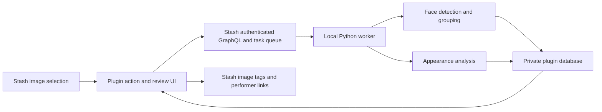

# Gallery People: upstream review and compatibility plan

Status: implementation plan, 27 October 2026. Preliminary code in `plugins/gallery-people` is an unfinished experiment, not an installable release. No face recognition or appearance-tagging accuracy has been established.

## Agreed product

A Windows user with thousands of images should be able to use normal Stash galleries, select a set of images, and choose **Analyze and tag selected images**. Processing happens on the machine running Stash. No images or face embeddings are uploaded to a recognition service.

The action detects faces, proposes groups of the same person, and generates image-specific hair-colour and visible skin-tone tags. The user can name groups, correct mistakes, and optionally connect a group to an existing Stash performer. New imports are **not** analyzed automatically: the user's final preference is selected images only.

“Sort” means browse and filter by person and appearance inside Stash. Moving or renaming files is outside this feature. Person identity and appearance are separate: a person may have different hair colours in different images.

## What upstream already does

The fork's base commit, `9e9ad972643320e737c711884f10e4285f0f3a88`, exactly matched upstream `stashapp/stash`'s `develop` HEAD when checked. The fork already contains the full Stash application; rebuilding it from scratch would add unnecessary compatibility work. Upstream `master` was `7c8590eb7b60eeb551d049bc5e2872595ef7b83d`. These are distinct targets; source compatibility is not evidence of tested release compatibility.

Stash is a self-hosted media manager, supporting images and videos, SQLite metadata, a Go/GraphQL backend, and a React interface. Existing capabilities to reuse:

- Folder, ZIP, and manually assembled galleries; an image can belong to multiple galleries.
- Image grids, selection, pagination, gallery navigation, lightbox, and metadata editing.
- Performer and tag relationships on images, plus existing filters for these relationships.
- YAML plugins with UI JavaScript/CSS, external Python tasks, progress, cancellation, and authenticated calls back to Stash.
- Auto-tagging based on names in file paths. This is not visual recognition.

Sources: [upstream project](https://github.com/stashapp/stash), [architecture](https://github.com/stashapp/stash/blob/9e9ad972643320e737c711884f10e4285f0f3a88/docs/ARCHITECTURE.md), [images and galleries](https://github.com/stashapp/stash/blob/9e9ad972643320e737c711884f10e4285f0f3a88/ui/v2.5/src/docs/en/Manual/Images.md), [auto-tagging](https://github.com/stashapp/stash/blob/9e9ad972643320e737c711884f10e4285f0f3a88/ui/v2.5/src/docs/en/Manual/AutoTagging.md).

## Existing community plugins reviewed

Reviewed CommunityScripts at `9cd5ce6607c39031af59197f997ddbf69a04b508`:

| Plugin | Relevant capability | Fit for this request |
| --- | --- | --- |
| [LocalVisage](https://github.com/stashapp/CommunityScripts/tree/9cd5ce6607c39031af59197f997ddbf69a04b508/plugins/LocalVisage) | Local matching against performers already represented by labeled images | Useful reference, but requires Python/DeepFace/TensorFlow, additional UI dependencies and a separate server; it does not supply the complete unnamed-group and appearance-tagging workflow. |
| [Visage](https://github.com/stashapp/CommunityScripts/tree/9cd5ce6607c39031af59197f997ddbf69a04b508/plugins/visage) | Performer suggestions from scene sprites, with confirmation | A different primary workflow. Its configuration permits a hosted backend as well as a local backend; a local-only product must explicitly enforce its own routing. |
| [Image Gallery Navigation](https://github.com/stashapp/CommunityScripts/tree/9cd5ce6607c39031af59197f997ddbf69a04b508/plugins/imageGalleryNavigation) | Gallery navigation and zoom on image detail pages | Useful interaction reference. Reuse Stash's existing viewer before adding another set of keyboard and pointer handlers. |

Recommendation: a self-contained Gallery People plugin using native Stash integration. Evaluate recognition engines independently; do not make these community plugins mandatory dependencies or copy their implementations without reviewing licenses and behavior.

## User experience

1. Open Images or a gallery and select images using Stash's existing selection tools.
2. Choose **Analyze and tag selected images**. Show the exact selection count and enabled categories: faces, hair colour, skin tone.
3. Run a background job with progress, cancellation, retry, and a summary of processed, unchanged, skipped, and failed images. Browsing remains available.
4. Open **People & appearance** to review face crops with their full-image context. Suggested groups have neutral names such as “Person 1”. Merge groups, split incorrect matches, exclude a face, and rename groups.
5. A local name is sufficient for browsing. Connecting a group to a Stash performer is an explicit operation showing the affected images before writing.
6. Apply qualifying appearance tags automatically to the selected images; keep uncertain predictions in a review queue. A correction persists across repeat analysis of unchanged content.
7. Browse by person, hair colour, or skin tone. Keep the native lightbox and existing metadata filters. Offer removal of plugin-created assignments without touching unrelated manual tags.

Image-level tags summarize which attributes occur in an image. In multi-person images, retain the face-to-attribute relationship separately. The plugin's combined person-plus-attribute filters must query that relationship so a second person's hair colour is not attributed to the selected person.

## Compatibility architecture

| Integration | Implementation contract |
| --- | --- |
| Selected-image action | Extend `FilteredImageList` through `PluginApi.patch.before`, appending `extraOperations` while preserving other plugins' operations. The callback receives the actual selected image IDs. This is used by gallery image lists as well as Images. |
| Review screen | Register `/plugin/gallery-people` with `PluginApi.register.route`; reuse Stash's React, router, components, and lightbox. Add a navigation entry through `MainNavBar.MenuItems`. Scope CSS to the plugin root. |
| Analysis | `runPluginTask` with explicit selected IDs. No scan-all default, import hook, or filesystem traversal. Empty selection must fail safely. |
| Short operations | `runPluginOperation` for status, paginated groups, review edits, and assignment commands. Validate every argument on the worker side. |
| Images | Query IDs and current media URLs with GraphQL. Read through authenticated Stash routes to support ZIP galleries and server filesystem paths. Preserve base paths and TLS verification; browser localhost and server localhost are different when accessed remotely. |
| Tag writes | `tagCreate` when needed, then `bulkImageUpdate` using `tag_ids` in `ADD` mode. Record which relationships were newly added. Never replace an image's complete tag list. |
| Person links | Use `performer_ids` in `ADD` mode after review. Do not equate an image's existing performer list with ground-truth identity for every detected face. |
| Worker protocol | Follow Stash's raw stdin/stdout JSON contract; progress uses its documented SOH/level/STX format. Do not write logs or credentials into stdout. Ensure cancellation terminates computation, including Windows child processes. |
| Storage | A separate, versioned SQLite database under the local Stash configuration/data directory. Store face bounds, embedding/model versions, content fingerprints, group membership, decisions, tag provenance, and job checkpoints. No schema changes or direct writes to Stash's SQLite database. |

The relevant plugin and GraphQL entry points exist in the reviewed stable and develop sources. `PluginApi` is explicitly experimental, so use capability checks and a tested-version matrix. Do not rely on develop-only `ReactDOMClient`, private DOM selectors, or an undocumented `GalleryPage.Tabs` hook. No core UI changes are presently necessary for the selected-image workflow.

Sources: [UI plugin contract](https://github.com/stashapp/stash/blob/9e9ad972643320e737c711884f10e4285f0f3a88/ui/v2.5/src/docs/en/Manual/UIPluginApi.md), [selected-image operation](https://github.com/stashapp/stash/blob/9e9ad972643320e737c711884f10e4285f0f3a88/ui/v2.5/src/components/Images/ImageList.tsx#L508), [external task protocol](https://github.com/stashapp/stash/blob/9e9ad972643320e737c711884f10e4285f0f3a88/ui/v2.5/src/docs/en/Manual/ExternalPlugins.md), [image update schema](https://github.com/stashapp/stash/blob/9e9ad972643320e737c711884f10e4285f0f3a88/graphql/schema/types/image.graphql).

## Recognition and appearance analysis

Treat these as separate components with replaceable model adapters:

- **Detection:** find all sufficiently visible faces, apply EXIF orientation, retain normalized bounds, and distinguish no detection from an unreadable/unsupported image.
- **Person grouping:** use pretrained embeddings to suggest matches among selected and previously reviewed local faces. Preserve unknown people and rejected matches. Similarity scores must not be presented as identity probabilities. Only user-labeled references may suggest a named person.
- **Hair colour:** analyze a hair region rather than averaging a whole portrait. Handle covered hair, baldness, greyscale images, mixed/dyed colours, and low resolution explicitly.
- **Visible skin tone:** analyze visible skin regions under a documented palette, with lighting/coverage checks. This is an appearance tag on an image, not an inference of race or ethnicity, and must not populate Stash's `ethnicity` field.

Candidate CPU components in the initial experiment are OpenCV YuNet/SFace. Their pinned model artifacts and licenses were inspected, but they have not been evaluated on the user's images and do not provide hair or skin segmentation. Selecting an appearance model, its weights, distribution license, and Windows CPU support is a required feasibility step. Do not ship a whole-image colour heuristic as a reliable subject attribute classifier.

Before selecting models or auto-apply thresholds, build a small, user-controlled local evaluation set spanning identities, hair colours, skin tones, lighting, occlusion, multi-person images, and formats. Inspect label balance, missing labels, duplicates, and image quality. Keep near-duplicates and photo sessions together when separating tuning from evaluation; report matching for known people separately from unseen identities. Measure false person merges/splits, per-class tag precision/recall, abstention rate, CPU time, and peak memory, with uncertainty estimates. No accuracy or processing-speed claim is justified yet.

Initial tag taxonomy proposal: `Gallery People / Hair / Brown`, `Gallery People / Skin tone / Medium`, and face-presence tags. Final categories and color palette are configurable. Machine predictions retain provenance, model version, and review state; manual corrections take precedence.

## Thousands of images

- Freeze the explicit image-ID selection at job submission; never treat a missing/empty selection as the entire library.
- Paginate GraphQL queries and the review screen. Bound decoded image size, batch size, memory, and CPU threads.
- Persist checkpoints after each image so cancellation/restart can resume a selected job.
- Cache by content fingerprint, preprocessing/model version, and selected analysis settings. Metadata edits should not trigger recognition again.
- Keep appearance predictions and named-identity approvals separate from embedding recomputation. A model change must not silently erase reviewed groups.
- Serialize writes, use short transactions, and support partial success. Re-running an assignment is idempotent; resuming must preserve tags added by another user or plugin.
- Before claiming large-library performance, benchmark selected batches against a growing local reference index. Replace repeated Python-wide comparisons with a measured vectorized/indexed strategy when needed.

## Windows delivery for a user without GitHub experience

The intended deliverable is a downloadable ZIP containing the Stash Windows executable, plugin files, a setup launcher, a start launcher, and plain-language instructions. End users should not need Git, Go, Node, or a source build.

The installer must detect Windows architecture, use a private Python runtime, verify downloaded runtime/model checksums, and install the plugin into the chosen Stash configuration directory. Do not change the system Python or another plugin's dependency environment. Keep the downloaded models and face database outside publicly served plugin assets. Offer a local-only connection by default and preserve existing Stash settings, authentication, media, and database.

Build and test the Windows package on a Windows runner. Linux cloud tests alone cannot establish that it works on Windows. A fresh-profile test must cover paths containing spaces/non-ASCII characters, offline operation after setup, cancellation, restart, upgrading, and removal. Retain upstream license notices and include model/runtime redistribution notices. Publishing a release is separate from preparing and testing the package.

## Implementation stages and exit criteria

1. **Establish the baseline:** build and run the unchanged Stash base; test gallery/image APIs and relevant existing tests. Record the supported upstream commit and release.
2. **Validate the plugin seam:** select images in both Images and Galleries, pass exactly those IDs through a plugin task, open a paginated review page, and show progress/cancellation. Verify another UI plugin still works.
3. **Validate local inference:** evaluate candidate face and appearance components on the local test set; verify Windows runtime, licenses, and offline execution. Finalize thresholds only from this evidence.
4. **Complete the workflow:** grouping, naming, merge/split/reject, automatic appearance tags, corrections, additive performer assignment, provenance-aware undo, and cache/resume behavior.
5. **Regression and packaging:** test ordinary Stash behavior, existing libraries, login, ZIP galleries, mixed formats, multi-person images, selected subsets, failure/restart, and Windows installation from a ZIP. Create the distribution and beginner guide only after these checks pass.

## Preliminary-code review

The initial experiment is not aligned with the final product yet. Its scan-all task must be removed in favor of explicit selections. It has no UI bundle or appearance analysis, no Windows package, no validated recognition thresholds, and insufficient preservation/undo semantics for reviewed results. Its local connection handling and progress encoding also need revision against the upstream contracts. Do not install it into a real library or call it complete.

## Current environment evidence

Go 1.25.14 was installed with its official SHA-256 verified. Node 24 and FFmpeg are available. The repository-pinned pnpm 10.33.0 installed the UI dependencies using its frozen lockfile. Go module checksums verified after fetching one blocked module directly from its official Git repository. UI code generation, TypeScript checking, and the frontend production build passed. Backend generation was stopped at the requested handoff; backend build/startup and functional checks remain outstanding.

Required cloud network additions are `storage.googleapis.com` for Go module artifacts, `media.githubusercontent.com` for public model weights, and `api.github.com` for pull-request creation. Saving a draft does not activate network access or publish the environment. Model-weight download and GitHub API requests received proxy denials; no local face model has been loaded or validated. The draft branch itself was successfully pushed using Git.
